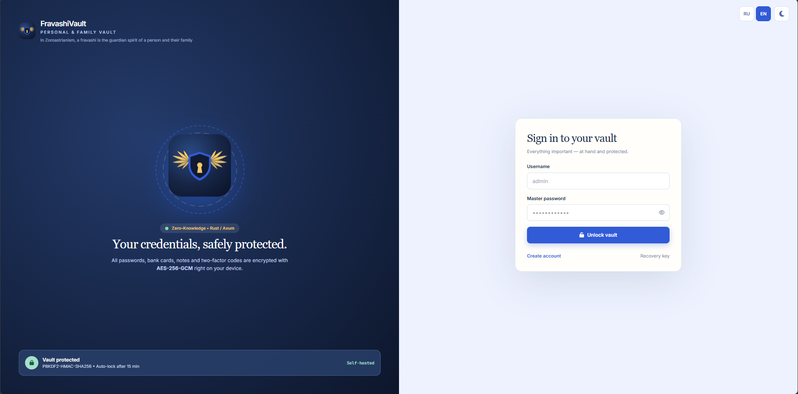
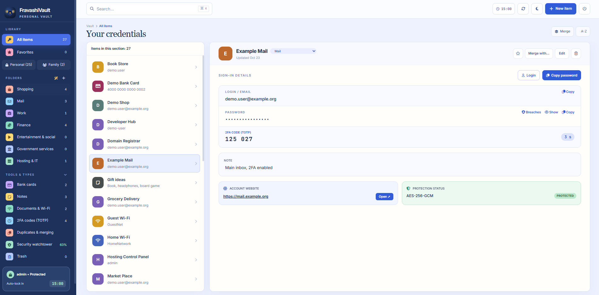
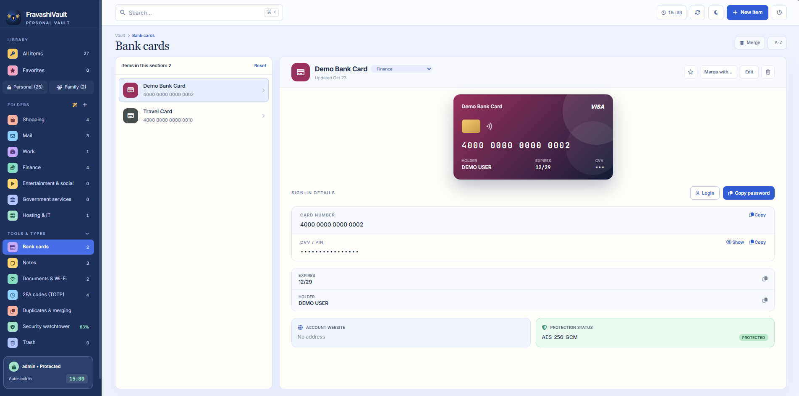
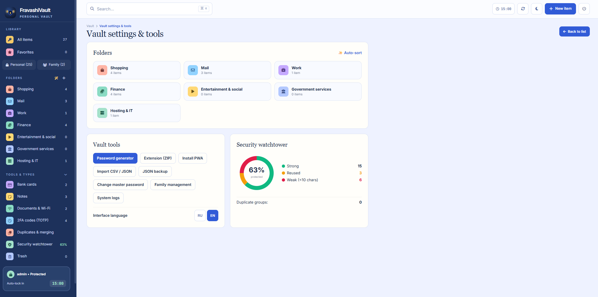
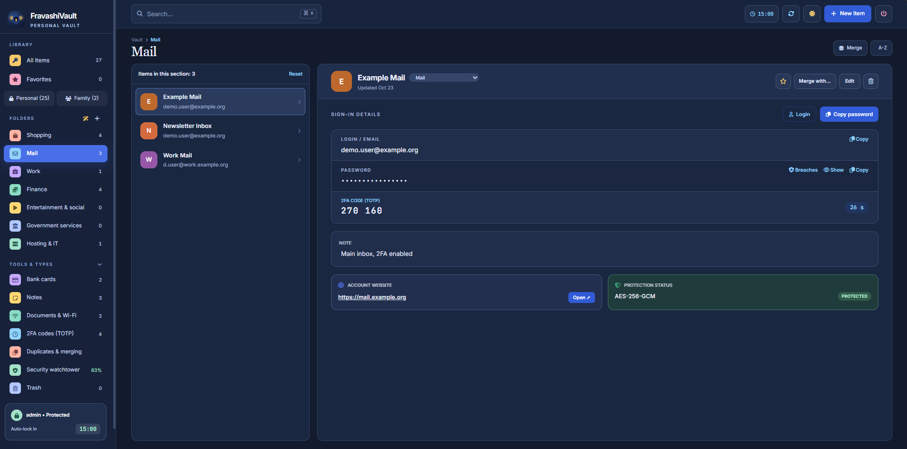

# FravashiVault

[English](README.md) | **Русский**

Self-hosted менеджер паролей с нулевым разглашением (zero-knowledge) для одного человека или семьи. Сервер хранит только зашифрованные данные: шифрование и расшифровка происходят в браузере.

Бэкенд: Rust (Axum, SQLite). Фронтенд: Vue, JavaScript собирать не нужно.

> **Disclaimer.** Независимый аудит безопасности не проводился. Есть только самопроверка ([AUDIT.md](AUDIT.md)). Используйте на свой риск и делайте собственные резервные копии.

## Возможности

- Типы записей: логины, банковские карты, дисконтные карты (штрихкод / QR-код, на весь экран для кассы), заметки, Wi-Fi (со сканируемым QR-кодом); несколько аккаунтов в одной записи, свои поля, история паролей, избранное, папки, корзина
- Одноразовые коды (TOTP): секрет хранится внутри зашифрованной записи, код считается в браузере
- Генератор паролей, обзор дубликатов и слабых паролей
- Проверка паролей на утечки через Have I Been Pwned по k-anonymity (на `api.pwnedpasswords.com` уходят только первые 5 символов SHA-1)
- Офлайн-режим: после успешного входа зашифрованные записи и обёрнутые ключи кэшируются в браузере; без сети можно войти мастер-паролем и читать (не менять) хранилище
- Устанавливаемое PWA (манифест и service worker, кэширующий оболочку приложения)
- Расширение браузера (Manifest V3), создаётся и скачивается из приложения: заполняет логины, а после явного подтверждения — банковские карты; интерфейс на русском и английском; доступ к вкладке только по нажатию на значок расширения (см. [Расширение браузера](#расширение-браузера))
- Импорт из JSON (формат этого приложения) и CSV; экспорт в JSON (без шифрования, см. ниже)
- Личные и семейные записи. Семейные шифруются общим семейным ключом и общие для правки: любой участник может изменить, отправить в корзину и окончательно удалить любую семейную запись. Сделать семейную запись личной может только участник, который её создал
- Инвайт-коды: администратор создаёт одноразовый код (60 минут из интерфейса, от 5 минут до 24 часов через API; 80 бит случайности), по нему регистрируется новый участник
- Аварийный ключ восстановления: позволяет задать новый мастер-пароль без потери данных
- Необязательный двухфакторный вход (TOTP): после мастер-пароля — код из приложения-аутентификатора, плюс 10 одноразовых резервных кодов; поддерживается и в расширении браузера (см. [Двухфакторный вход](#двухфакторный-вход-totp))
- Администратор может сбросить пароль участника (что это значит — в модели угроз)
- Автоблокировка после 15 минут бездействия; буфер обмена очищается через 30 секунд после копирования пароля
- Журнал событий безопасности для администратора (хранится в памяти сервера: последние 300 записей, при перезапуске теряется)
- Интерфейс на русском и английском

## Параметры

| Что | Значение | Где |
|---|---|---|
| Шифрование записей | AES-256-GCM, в браузере | `static/app.js` |
| KDF мастер-пароля | PBKDF2-HMAC-SHA256, 600 000 итераций | `KDF_ITERATIONS` в `static/app.js` |
| Разделение ключей | HKDF-SHA256 с отдельными метками для ключа шифрования, значения входа, escrow и инвайтов | `static/app.js` |
| Хеширование значения входа на сервере | Argon2id (параметры по умолчанию крейта: 19 МиБ памяти, 2 прохода, 1 поток), не более 4 хешей одновременно | `main.rs` |
| Квота на пользователя | 50 МиБ шифртекста личных записей; семейные записи делят одну квоту 50 МиБ; не более 20 000 записей на пользователя | `MAX_BYTES_PER_USER`, `MAX_ITEMS_PER_USER` |
| Один запрос | тело до 512 КиБ; пакет импорта до 5 000 записей / 16 МиБ | `main.rs` |
| Сессия | истекает через 12 ч бездействия и не позже чем через 24 ч после входа | `SESSION_TTL`, `SESSION_ABS_TTL` |
| Двухфакторный вход | TOTP (RFC 6238): HMAC-SHA1, 6 цифр, шаг 30 секунд, принимается соседний шаг (±1), уже использованный шаг отклоняется; секрет хранится зашифрованным AES-256-GCM ключом, выведенным из секрета сервера; 10 резервных кодов по 80 бит, в базе только их HMAC | `main.rs` |
| Лимиты попыток (окно 15 минут) | вход: 20 на IP и 10 на логин; второй шаг входа (код): 20 на IP и 10 на пользователя, а одна ожидающая попытка входа аннулируется после 5 неверных кодов или через 5 минут; включение и отключение двухфакторного входа: 20 / 10; смена пароля: 20 / 10; восстановление: 10 / 10; регистрация: 10 на IP; проверка инвайта: 10 на IP; сброс пароля участника администратором: 5 на IP и 5 на администратора; параметры KDF: 60 на IP в минуту | `main.rs` |
| Заголовки ответов | `Content-Security-Policy`, `X-Frame-Options: DENY`, `X-Content-Type-Options: nosniff`, `Referrer-Policy: no-referrer`, `Strict-Transport-Security` (1 год), `Permissions-Policy` (камера, микрофон, геолокация выключены), `Cache-Control: no-store` для `/api/` | `security_headers_middleware` |

## Модель угроз

- **Zero-knowledge для содержимого.** Данные записей шифруются в браузере AES-256-GCM. Мастер-пароль обрабатывается PBKDF2; ключ шифрования и значение для входа выводятся отдельно через HKDF, поэтому сервер никогда не получает ключ, которым можно расшифровать данные.
- **На сервере.** Значение для входа, присланное клиентом, хешируется ещё раз Argon2id перед сохранением.
- **От чего защищает:** от кражи или утечки базы или резервной копии сервера (мастер-пароль всё равно придётся подбирать); от оператора сервера, который только читает базу; от пассивного наблюдения за сетью (при HTTPS).
- **Что сервер видит (метаданные):** имена пользователей, какие записи существуют, их размеры, метку папки/категории, признаки «избранное» и «в корзине», область (личная/семейная), время изменений. IP-адреса и время запросов видит ваш обратный прокси.
- **Администратор семьи.** В форме регистрации нового участника есть галочка «Разрешить Админу восстановить мой доступ», **по умолчанию она включена**. Если участник её не снял, копия его ключа сейфа запечатывается ключом администратора (ECDH P-256). Это позволяет администратору сбросить забытый мастер-пароль, и это же означает, что администратор технически может получить доступ к личным записям этого участника. Если галочку снять, копия не создаётся: администратор не сможет сбросить пароль, сработает только собственный аварийный ключ участника. Выбор делается один раз, при регистрации. Назначайте администраторами только тех, кому доверяете.
- **Семейные записи** общие для правки и удаления всеми участниками (см. «Возможности»). То, что другие не должны иметь возможности удалить, держите в личных записях.
- **Логины не раскрываются** тому, кто не вошёл: для неизвестного логина сервер отдаёт соли, вычисленные из секрета сервера, а восстановление возвращает одну и ту же ошибку и для неизвестного логина, и для неверного аварийного ключа.
- **Блокировка входа — известный компромисс.** После 10 неудачных попыток входа для одного логина за 15 минут следующие попытки для этого логина отклоняются до конца окна, с любого IP-адреса. Это замедляет подбор пароля, но и тот, кто знает ваш логин, может на время закрыть вам вход.
- **Офлайн-копия в браузере.** Для офлайн-режима браузер хранит в локальном хранилище зашифрованные записи, обёрнутый ключ сейфа и соль, и после выхода они остаются. Без мастер-пароля они бесполезны, но любой, у кого есть доступ к этому профилю браузера, может их скопировать и подбирать пароль офлайн. На общих и чужих компьютерах после работы очищайте данные сайта (настройки браузера → данные сайта для этого адреса).
- **От чего НЕ защищает:**
  - от слабого мастер-пароля: у кого есть база, тот может подбирать его офлайн;
  - от вредоносных программ, кейлоггеров и расширений на вашем устройстве;
  - от скомпрометированного или недобросовестного сервера: JavaScript приходит с сервера при каждом заходе, поэтому изменённый сервер может подсунуть код, крадущий пароль. Свой собственный сервер снижает этот риск, но не убирает его;
  - от потери мастер-пароля вместе с ключом восстановления: другого пути назад нет;
  - от судьбы экспортированного JSON: он **не зашифрован** и содержит все пароли;
  - от доступа к открытому приложению: пока оно открыто, расшифрованный ключ сейфа находится в памяти браузера.
- **Независимый аудит безопасности не проводился.** Есть только самопроверка ([AUDIT.md](AUDIT.md)).
- HTTPS обязателен. Запускайте сервис только за обратным прокси с действующим сертификатом.

## Двухфакторный вход (TOTP)

Необязательный, включается каждым пользователем для себя. Кто его не включил, входит как раньше.

- **Как включить.** Настройки и инструменты → Двухфакторная защита. Введите мастер-пароль, отсканируйте QR-код приложением-аутентификатором (Aegis, 2FAS, Google Authenticator и т. п.) или введите ключ вручную, затем введите 6-значный код. Двухфакторный вход начинает действовать только после верного кода. QR-код рисуется в браузере.
- **Резервные коды.** Сразу после включения **один раз** показываются 10 резервных кодов с кнопками «Копировать» и «Скачать». Храните их отдельно от телефона. Каждый код срабатывает один раз вместо кода из приложения; в окне видно, сколько осталось. Сервер хранит только HMAC каждого кода.
- **Вход.** После мастер-пароля приложение спрашивает код; по ссылке «Использовать резервный код» можно ввести резервный. В расширении браузера такой же второй шаг.
- **Как отключить.** В том же окне: мастер-пароль и код из приложения или резервный код.
- **Что даёт.** Тот, кто узнал ваш мастер-пароль (фишинг, тот же пароль на другом сайте), без кода не войдёт на сервер: не получит сессию и не скачает зашифрованный сейф через API.
- **Чего НЕ даёт:**
  - защищает вход в аккаунт, а не шифрование: записи по-прежнему шифруются только ключами из мастер-пароля, секрет TOTP в шифровании не участвует;
  - тому, у кого есть копия базы или бэкап, код не нужен: он подбирает мастер-пароль офлайн, как и раньше;
  - офлайн-режим код не спрашивает: зашифрованная копия в браузере открывается одним мастер-паролем;
  - секрет TOTP зашифрован ключом, выведенным из секрета сервера, а тот лежит в той же базе (`server_meta`). Это защищает от утечки одной таблицы TOTP, но не от кражи всего файла базы;
  - уже открытые сессии при включении двухфакторного входа не завершаются.
- **Потеряли телефон.** Введите резервный код. Если резервных кодов нет: сброс мастер-пароля по аварийному ключу (ссылка «Аварийный ключ» на экране входа) заодно отключает двухфакторный вход; так же действует сброс пароля участника администратором (только для участников, которые разрешили это при регистрации). После этого войдите с новым паролем и при желании включите двухфакторный вход заново. Это значит, что аварийный ключ, а для таких участников и администратор, позволяют обойти второй фактор: храните аварийный ключ так же надёжно, как резервные коды.

## Расширение браузера

Собирается в браузере по кнопке «Скачать fravashi-extension.zip» (`static/extension-build.js`) и устанавливается как распакованное расширение в браузерах для ПК на движке Chromium. Адрес сервера и язык окна берутся из приложения в момент скачивания; если такого языка нет — язык браузера. Версия 1.3.2.

**Установка по шагам:**

1. Войдите в приложение по `https://` и откройте «Настройки и сервисы» → «Инструменты хранилища» → «Расширение (ZIP)» → «Скачать fravashi-extension.zip». Архив собирается под адрес вашего сервера, поэтому скачивайте его с того сервера, которым будете пользоваться.
2. Распакуйте zip в папку, которую сохраните (браузер читает расширение оттуда).
3. В Chrome, Edge, Brave или другом браузере на Chromium откройте `chrome://extensions` (Edge: `edge://extensions`) и включите «Режим разработчика».
4. Нажмите «Загрузить распакованное расширение» и выберите папку.

Расширение работает только с адресом сервера по `https://`.

**Разрешения** (`manifest.json`):

| Разрешение | Зачем |
|---|---|
| `activeTab` | доступ к текущей вкладке только после нажатия на значок расширения и только пока вкладка не ушла на другой сайт; к другим вкладкам и в фоне доступа нет |
| `scripting` | запустить функцию заполнения в этой вкладке (`chrome.scripting.executeScript`) по нажатию кнопки в окне расширения |
| доступ только к адресу сервера (`https://<ваш сервер>/*`) | вход и загрузка зашифрованного сейфа через API |

Нет `<all_urls>`, нет content scripts на всех сайтах, нет `tabs`, `storage`, `clipboardWrite`, cookies и истории. Расширение ничего не сохраняет: мастер-пароль (и код) спрашиваются при каждом открытии окна. В версии 1.2.0 и раньше были `<all_urls>`, `tabs`, `storage` и content script на всех сайтах; чтобы их убрать, переустановите расширение.

**Заполнение логина.** «⚡ Заполнить» сверяет сайт во вкладке с адресом в записи (тот же хост или его поддомен). Если они не совпадают или адреса в записи нет, показывается предупреждение, и заполнение — только после подтверждения. Функция заполнения на странице ещё раз сверяет хост, поэтому если страница тем временем ушла на другой сайт, ничего не заполняется.

**Заполнение банковской карты.** У записей-карт есть кнопка «Заполнить карту». Сама она ничего не заполняет: в окне расширения всегда появляется подтверждение с названием карты, последними 4 цифрами и хостом текущей страницы и отдельной галочкой «Заполнить CVV», которая по умолчанию **выключена**. Данные уходят на страницу только после нажатия «Заполнить». Откуда берутся данные: номер карты — поле «Логин» записи, CVV — поле «Пароль», срок и владелец — доп. поля с подписями «Срок»/«Expiry» и «Владелец»/«Holder» (как в приложении). Поля ищутся по `autocomplete` (`cc-number`, `cc-exp`, `cc-exp-month`, `cc-exp-year`, `cc-name`, `cc-csc`), затем по `name`/`id`/`placeholder`/`aria-label` на английском и русском; только видимые и доступные для ввода `<input>` самой страницы. Срок принимается в виде ММ/ГГ или ММ/ГГГГ и записывается в формате, который подсказывает поле.

**Ограничения:**
- платёжные формы, встроенные платёжным сервисом (`<iframe>` с другого домена), заполнить нельзя; расширение не пытается это обойти и пишет «Поля карты не найдены на этой странице или находятся во вложенной платёжной форме»;
- выпадающие списки `<select>` для месяца и года и номер карты, разбитый на четыре поля, не заполняются;
- проверка хоста не отличит похожий домен, сохранённый в записи, от настоящего, а у карты адреса для сравнения нет: прочитайте хост в подтверждении, прежде чем нажать «Заполнить»;
- поле «Пароль» у карты в приложении подписано «CVV / ПИН»: если храните там ПИН, не ставьте галочку «Заполнить CVV»;
- страница получает подставленные данные так же, как при ручном вводе: заполняйте карту только на сайтах, которым доверяете.

## Roadmap

Порядок — не обещание.

- done: необязательный двухфакторный вход (TOTP), см. [Двухфакторный вход](#двухфакторный-вход-totp)
- done: расширение браузера 1.3.2 — английский интерфейс, узкие права (`activeTab`, `scripting`, только адрес сервера), автозаполнение банковской карты с подтверждением, см. [Расширение браузера](#расширение-браузера)
- сознательно отложено: сессия расширения браузера («оставаться разблокированным N минут»). Пока расширение спрашивает мастер-пароль (и код, если включён двухфакторный вход) при каждом открытии окна
- planned: быстрый вход по Face ID / Touch ID / Windows Hello / пасскею (WebAuthn PRF)
- done: дисконтные карты со штрихкодом / QR-кодом (EAN-13, EAN-8, Code 128, Code 39, QR); расширение их пропускает
- planned: заполнение списков `<select>` для срока и номера карты, разбитого на несколько полей, в расширении
- done: в CSP нет `unsafe-eval`: шаблон Vue предкомпилирован (`static/app-render.js`), страница работает на runtime-only сборке Vue
- planned: учитывать метаданные в квоте
- **Не планируется:** оплата в магазине (NFC). Это менеджер паролей, а не кошелёк.

## Быстрый старт (Docker)

Нужны Docker с Compose и, для любого доступа не с самого хоста, обратный прокси с HTTPS (nginx, Caddy, Traefik, обратный прокси Synology DSM и т. п.).

**Зачем HTTPS.** Приложение шифрует всё в браузере через Web Crypto API (`crypto.subtle`), а браузеры дают его только в защищённом контексте. Открыть сервер по обычному `http://` с другого устройства не получится. Адреса `http://127.0.0.1:8585` и `http://localhost:8585` браузеры считают безопасными, поэтому проверить приложение на самом хосте можно и без прокси. Расширение браузера тоже работает только с адресом сервера по `https://`.

```sh
git clone https://github.com/miki-113/fravashi-vault.git fravashi
cd fravashi
mkdir data
cp .env.example .env        # Windows (PowerShell): Copy-Item .env.example .env
```

Отредактируйте `.env` (все переменные описаны в `.env.example`). `VAULT_UID` и `VAULT_GID` должны совпадать с владельцем каталога `./data` (узнать: `stat -c '%u:%g' data`; по умолчанию 1000:1000).

**Права на `data/` (только Linux).** Сделайте этого пользователя владельцем каталога:

```sh
sudo chown -R 1000:1000 ./data && sudo chmod 700 ./data
```

В Docker Desktop (Windows/macOS) это не нужно. Затем запустите:

```sh
docker compose up -d --build
```

Если имена `fravashi` (контейнер или образ) конфликтуют с уже запущенным, уберите `container_name` и `image` из `docker-compose.yml`.

Контейнер слушает только `127.0.0.1:8585` (напрямую из сети он недоступен). Поставьте перед ним обратный прокси с HTTPS, например для `https://vault.example.com`:

```
# Caddy (Caddyfile)
vault.example.com {
    reverse_proxy 127.0.0.1:8585 {
        header_up X-Forwarded-For {remote_host}
        header_up X-Forwarded-Proto {scheme}
    }
}
```

```
# nginx (внутри server-блока с вашим TLS-сертификатом)
location / {
    proxy_pass http://127.0.0.1:8585;
    proxy_set_header Host $host;
    proxy_set_header X-Forwarded-For $proxy_add_x_forwarded_for;
    proxy_set_header X-Forwarded-Proto $scheme;
}
```

**Зарегистрируйте владельца до того, как экземпляр станет доступен из интернета.** Пока нет ни одного аккаунта, любой, кто откроет адрес, может зарегистрироваться и стать администратором. Чтобы закрыть это окно, задайте в `.env` переменную `SETUP_TOKEN` с длинной случайной строкой:

```sh
openssl rand -hex 16        # результат впишите в SETUP_TOKEN=... в .env
docker compose up -d        # применить изменение
curl http://127.0.0.1:8585/api/status
```

В ответе `/api/status` должно быть `"setup_token_required": true` (после создания администратора или без токена там `false`). При первой регистрации появится поле «Токен первой настройки», и регистрация пройдёт только с совпадающим значением (сравнение в постоянное время). После создания администратора токен больше не используется, его можно убрать. Если `SETUP_TOKEN` не задан, первая регистрация работает без него.

**Первая регистрация.** Откройте адрес и зарегистрируйтесь: первый пользователь становится администратором и затем приглашает остальных членов семьи одноразовыми кодами. После регистрации приложение покажет **ключ восстановления**. Скачайте его и храните отдельно от мастер-пароля (не в том же менеджере паролей и не рядом с паролем). Мастер-пароль и ключ восстановления — единственный путь к данным: если потеряны **оба**, данные не восстановить никому, включая администратора сервера.

**Обратный прокси и IP-адреса клиентов.** Лимиты попыток считаются по IP клиента. За прокси сервер видит адрес прокси, поэтому адрес клиента берётся из **последнего** значения `X-Forwarded-For`. Прокси должен дописывать адрес клиента в этот заголовок (см. примеры выше). Заголовку верим, только если соединение пришло с доверенного адреса прокси: по умолчанию это loopback и частные диапазоны (`127.0.0.0/8`, `::1`, `10.0.0.0/8`, `172.16.0.0/12`, `192.168.0.0/16`, `fc00::/7`), что покрывает прокси на том же хосте и шлюз Docker. Чтобы изменить список, задайте `TRUSTED_PROXIES` — адреса или подсети через запятую, либо `none`, чтобы не учитывать заголовок вовсе. Не публикуйте порт контейнера в сеть (оставьте `127.0.0.1:8585`): иначе клиент, подключающийся напрямую из частного диапазона, сможет подделать свой адрес.

Контейнер запускается от непривилегированного пользователя, корневая файловая система только для чтения, все capabilities отключены. Synology NAS — лишь пример хоста: подойдёт любая машина с Docker.

## Сборка из исходников

Нужна актуальная стабильная версия Rust.

```sh
cargo build --release --locked
DB_PATH=./data/vault-v2.db ./target/release/fravashi   # порт 8000
cargo test
node --test tests/*.mjs
```

Бинарь отдаёт `index.html` и каталог `static/` из текущего каталога.

После правки разметки внутри `<div id="app">` в `index.html` пересоберите предкомпилированный шаблон и закоммитьте `static/app-render.js` (Node.js нужен только для этого шага, не для Docker и не для запуска сервера):

```sh
npm install
npm run build:templates
```

`node --test` падает, если `static/app-render.js` устарел.

## Резервное копирование и восстановление

Всё состояние лежит в каталоге `data/` (база SQLite `vault-v2.db` и WAL-файлы). Перед копированием остановите контейнер, иначе копия может оказаться неконсистентной:

```sh
docker compose stop
sudo cp -a data /путь/к/копии/data-$(date +%F)
docker compose start
```

`sudo` нужен, потому что файлы принадлежат `VAULT_UID`; `cp -a` сохраняет владельца и права.

Для восстановления остановите контейнер, замените содержимое `data/` копией, верните владельца (`sudo chown -R <VAULT_UID>:<VAULT_GID> data`) и запустите снова. Храните копии в надёжном месте: они зашифрованы, но их можно подбирать офлайн. Иногда делайте и JSON-экспорт из приложения; этот файл **не зашифрован**, удаляйте его после использования.

## Обновление

1. Сделайте резервную копию `data/` (см. выше).
2. Обновите и пересоберите:

```sh
git pull
docker compose up -d --build
```

После обновления переустановите расширение браузера и PWA, если в описании релиза сказано, что изменилась схема ключей или кэши.

## Скриншоты

**Экран входа**



**Список записей и карточка**



**Банковская карта**



**Папки, инструменты и дозор безопасности**



**Тёмная тема**



Все данные на скриншотах вымышленные.

## О названии

Фравáши (авест. *fravashi*) — в зороастризме дух-хранитель человека и рода. Это семейное хранилище, и название подходит.

## Лицензия

[GNU Affero General Public License v3.0](LICENSE). Если вы запускаете изменённую версию программы и предоставляете пользователям доступ к ней по сети, вы обязаны предложить этим пользователям исходный код вашей изменённой версии. Сторонние компоненты и их лицензии перечислены в [THIRD_PARTY_NOTICES.md](THIRD_PARTY_NOTICES.md).

Copyright (C) 2026 FravashiVault contributors

## Безопасность

О найденной уязвимости сообщайте по инструкции в [SECURITY.md](SECURITY.md); публичные issue для этого не используйте. Самопроверка — в [AUDIT.md](AUDIT.md).
